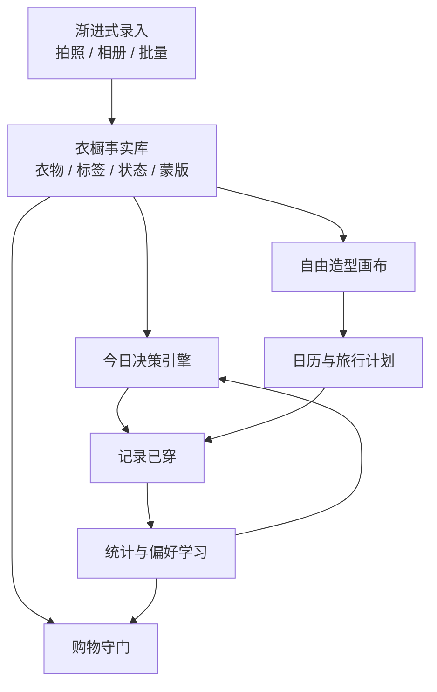
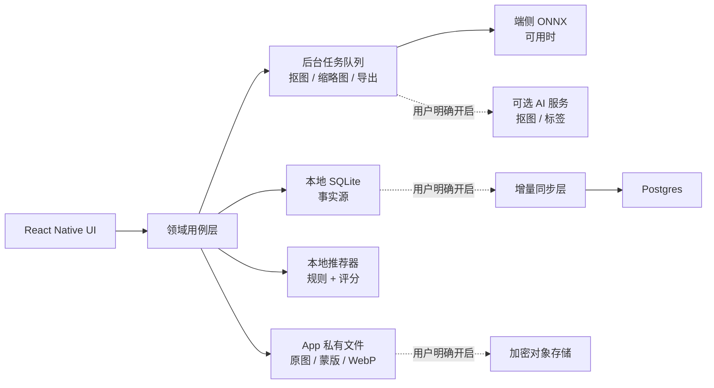

# Clothes 智能衣橱完整产品方案

版本：V1.0  
日期：2026-07-27  
参考产品：[Stylebook](https://www.stylebookapp.com/)  
项目定位：面向中国用户的本地优先、可解释、跨平台智能衣橱

## 1. 一句话结论

不做一个“把衣服照片存起来”的电子相册，而做一个每天真正被打开的穿衣决策工具：

> 用 12 件常穿衣物完成首次激活，之后每天 30 秒得到一套可解释、可替换、可记录的真实穿搭。

Stylebook 已经证明了数字衣橱、自由造型画布、日历、旅行清单、穿着统计和购物清单的长期价值。我们的差异化不是照搬界面，而是解决三件更难的事：

1. 把首次录入从“大工程”变成 10 分钟可获得回报的渐进流程。
2. 把静态衣橱升级为每天主动工作的“今日决策层”。
3. 把 AI 变成可解释、可关闭、可本地运行的辅助能力，而不是黑盒聊天入口。

## 2. 参考边界

Stylebook 官网列出的核心能力包括：真实衣物目录、自由画布造型、穿搭日历、旅行打包清单、穿着统计、购物候选、批量导入、背景移除和设备同步。

本项目借鉴的是问题空间和成熟功能范式，不复制其商标、品牌名、文案、图标、截图、素材或像素级布局。产品信息架构、交互、视觉语言和推荐机制均重新设计。

## 3. 用户痛点、爽点与机会

| 阶段 | 用户痛点 | 设计解法 | 用户爽点 |
|---|---|---|---|
| 首次使用 | “要把整柜衣服都拍完，太累” | 12 件启动包；6 件先预览价值；批量抠图 | 10 分钟就看到第一套真实搭配 |
| 每天出门 | 衣服很多，仍不知道穿什么 | 今日页直接给一套；天气、场景、干净状态先过滤 | 打开即答案，不进入复杂工具 |
| 推荐不满意 | AI 只会整套重来，不懂具体哪里不对 | “只换这件”“保留主角单品”“换一套” | 用户掌握最后决定权 |
| 不信任推荐 | 不知道为什么推荐，也不知道为何没选另一件 | 显示硬约束与推荐理由 | 推荐可理解、可校正 |
| 衣物利用低 | 总穿固定几件，闲置不可见 | 久未穿加分、月度盘活、成本/次 | 重新穿出新组合，少买也有新鲜感 |
| 旅行打包 | 按天想了搭配，仍会重复或漏带 | 按造型反推并去重的清单 | 一键得到真实、可勾选的行李清单 |
| 购物冲动 | 新商品与衣橱重复，买后难搭 | 相似单品提醒、可组成造型数、预计成本/次 | 买前获得“衣橱证据” |
| 隐私顾虑 | 衣物、消费、照片很私人 | 无账号可用；本地数据库；AI 能力逐项开关 | 数据归用户，断网仍能用 |

## 4. 目标用户与核心任务

### 4.1 第一目标用户

- 25–40 岁城市通勤用户，衣物 80–300 件。
- 每周至少 3 天有明确穿衣场景。
- 不一定懂时尚，但在意得体、效率和衣物利用率。
- 愿意整理，但无法接受先录完全部衣物才获得价值。

### 4.2 次级用户

- 高频旅行、差旅用户。
- 想减少冲动购买或实践胶囊衣橱的人。
- 造型师、内容创作者及需要管理多个衣橱的人；放在后续专业版。

### 4.3 三个最高频 JTBD

1. 当我准备出门时，帮我在 30 秒内决定今天穿什么。
2. 当我想盘活衣橱时，告诉我已有衣服还能形成哪些可靠组合。
3. 当我准备旅行或购买新衣时，基于我的真实衣橱减少漏带和重复购买。

## 5. 产品定位与核心卖点

### 卖点一：12 件即可开始

首轮不是“建立完整数据库”，而是形成最小可搭配集合：3 件上装、3 件下装、2 双鞋、2 件外套、2 件自由单品。录到 6 件先展示预览，录到 12 件解锁第一组推荐。

### 卖点二：今天穿什么，直接给答案

首页不展示管理入口堆栈，而是给出一套可穿的真实搭配。天气、场景、洗护状态是硬约束；个人偏好、久未穿和新鲜度用于排序。

### 卖点三：推荐可解释、只换一件

每套推荐显示 2–3 条真实理由，例如“适合 24–29℃”“满足通勤”“这件衬衫 18 天未穿”。不满意时可以固定其余单品，只替换一个槽位。

### 卖点四：本地优先，不用账号也能用

衣物、造型和穿着记录以本地 SQLite 为事实源。云同步、云端 AI 和跨设备备份是用户主动开启的可选层。

### 卖点五：购物守门

把“买不买”转化为可验证问题：衣橱是否已有相似款、能组成几套造型、是否补足明确缺口、预计成本/次是多少。

## 6. 产品架构

主导航固定为四项：`今天 / 衣橱 / 造型 / 计划`。统计、购物守门、同步与隐私从相关任务或个人设置进入，避免底部导航膨胀。



### 6.1 核心模块

| 模块 | 用户价值 | P0 能力 |
|---|---|---|
| 首次激活 | 快速获得第一份价值 | 12 件启动包、批量导入、自动抠图审核、低置信字段确认 |
| 今天 | 降低每日决策成本 | 一套推荐、理由、换一件、换一套、记录已穿 |
| 衣橱 | 维护真实衣物资产 | 分类、搜索、筛选、详情、状态、穿着历史 |
| 造型 | 人工创造与保存组合 | 快速槽位、自由画布、保存、变体 |
| 计划 | 把造型用于未来任务 | 日历、旅行、按造型去重打包 |
| 洞察 | 让记录产生持续回报 | 久未穿、成本/次、月度盘活 |
| 购物守门 | 减少重复与冲动购买 | 相似款、兼容造型、衣橱缺口 |
| 信任 | 降低隐私与迁移风险 | 本地模式、导出、删除、AI 与同步开关 |

## 7. 三条关键用户闭环

### 7.1 首次激活闭环

`欢迎 → 目标选择 → 添加 6 件 → 看到预览 → 补足 12 件 → 第一套推荐 → 进入今天`

关键原则：

- 每件只确认低置信字段，避免长表单。
- 自动抠图永远保留原图，审核页提供手工修边。
- 用户可以随时退出，回到原进度。
- 不用账号、不授权定位也不阻塞首轮价值。

### 7.2 每日穿衣闭环

`打开今天 → 看一套 → 接受或只换一件 → 记录已穿 → 更新干净状态 → 次日推荐变好`

北极星行为不是“浏览了多少件”，而是“成功决定并记录一套”。

### 7.3 旅行闭环

`创建旅行 → 设置天气与活动 → 安排每日造型 → 自动去重 → 勾选打包 → 旅行后复盘`

系统只根据已安排造型生成清单，不假装理解所有旅行需求；用户可手工添加独立单品和生活用品。

## 8. 推荐系统方案

### 8.1 MVP 不先做端到端生成式 AI

推荐的第一版采用“硬约束过滤 + 可解释打分 + 用户反馈重排”，比大模型直接生成更稳定、更便宜，也更容易解释。

候选生成：

1. 过滤不可用单品：待洗、干洗、借出、归档。
2. 过滤明显不适合季节、温度、降雨和场景的单品。
3. 按槽位形成合法组合：上装 + 下装/连衣裙 + 鞋，可选外套与配饰。
4. 用配色、正式度、轮廓和材质规则剔除明显冲突。

排序建议：

```text
总分 =
  场景适配 25%
  天气适配 20%
  个人偏好 20%
  衣橱盘活 15%
  单品兼容 10%
  新鲜度与重复控制 10%
```

推荐结果必须同时保存 `reason_codes`，例如：

- `WEATHER_MATCH_24_29`
- `OCCASION_COMMUTE`
- `NOT_WORN_18_DAYS`
- `FAVORITE_COLOR_NAVY`
- `REPEAT_SUPPRESSION`

前端只把真实命中的 2–3 条理由翻译成人话。若天气不可用，明确切换到用户手选城市或无天气模式，不伪造天气。

### 8.2 个性化学习

采集低负担反馈：

- 接受整套。
- 替换哪个槽位、换成什么。
- 穿后舒适度。
- 收藏、跳过和跳过原因。

先用加权规则和多臂老虎机做轻量重排；数据量足够后再评估个性化排序模型。用户可以清空偏好学习记录。

## 9. 技术实现方案

### 9.1 推荐技术栈

| 层 | 选择 | 原因 |
|---|---|---|
| 移动端 | React Native + Expo + TypeScript | 一套业务代码覆盖 iOS/Android，适合快速验证；需要相机、相册、SQLite、文件系统等能力 |
| 导航与 UI | Expo Router + 自建 Token/组件层 | 路由清晰；视觉方向不被通用组件库限制 |
| 本地数据 | SQLite；图片存 App 私有文件目录 | 结构化查询、离线可用、数据可导出 |
| 本地安全 | SecureStore/Keychain/Keystore 保存密钥 | 不把令牌和密钥写入普通数据库 |
| 可选后端 | Supabase Postgres + S3 兼容对象存储 | 快速获得认证、行级权限、数据库和对象存储；仅同步用户选择的数据 |
| 可选同步 | PowerSync 或自研操作日志同步 | 客户端 SQLite 继续是即时读写层；冲突可追踪 |
| 图像服务 | FastAPI + rembg/ONNX Runtime，支持自托管 | MVP 可先验证抠图质量；后续将合适模型下沉端侧 |
| 分析 | 本地事件聚合 + 可选匿名遥测 | 隐私敏感数据不默认上报 |

### 9.2 数据与服务架构



### 9.3 图像处理流水线

```text
导入原图
→ EXIF 方向归一化
→ 生成安全哈希和缩略图
→ 抠图模型输出 alpha mask
→ 边缘置信度检测
→ 用户审核 / 手工擦除与恢复
→ 保存原图 + 蒙版 + 合成预览
→ 生成 WebP/PNG 多尺寸派生图
```

必须保留：

- 原图不可被覆盖。
- 蒙版可重新编辑。
- 推理失败时允许跳过抠图，不阻塞衣物入库。
- 批量处理使用持久队列，App 被杀后可恢复。
- 云端处理前显示上传内容、用途、保存期限和删除入口。

### 9.4 建议的数据模型

核心表：

- `garments`：单品基础信息、类别、状态、价格、购买日、归档时间。
- `garment_assets`：原图、蒙版、派生图、哈希、尺寸、本地/远端状态。
- `garment_tags`：颜色、季节、场景、材质、正式度及置信度。
- `looks`、`look_items`：造型及画布中的位置、缩放、旋转、层级。
- `wear_logs`、`wear_log_items`：实际穿着、场景、反馈。
- `plans`：未来日期、时间段和场景。
- `trips`、`trip_days`、`trip_looks`、`packing_items`。
- `recommendations`、`recommendation_items`、`reason_codes`、`feedback_events`。
- `shopping_candidates`、`similarity_results`。
- `sync_operations`：可重放的增量变更，不与 UI 状态混在一起。

ID 使用 UUIDv7；业务时间保存 UTC，另存用户时区；删除采用可恢复墓碑，完成同步后再清理物理文件。

## 10. GitHub 开源方案优先级

以下结论按 2026-07-27 的公开仓库状态整理。任何正式商用集成都要再次锁定版本并审查“代码许可证 + 模型权重许可证 + 训练数据许可”。

| 项目 | 可借鉴/使用 | 许可证判断 | 建议 |
|---|---|---|---|
| [Libre Closet](https://github.com/Lazztech/Libre-Closet) | 衣物目录、造型、日程、离线 PWA、自托管、SQLite/Postgres、背景移除 | AGPL-3.0 | 非常好的功能与领域模型参考；若闭源商业化，不直接复制/链接其代码，除非接受 AGPL 义务 |
| [wardrowbe](https://github.com/Anyesh/wardrowbe) | AI 衣橱与推荐实现参考 | 必须逐文件复核 | 仅作调研；许可证不清晰前不进入产品代码 |
| [rembg](https://github.com/danielgatis/rembg) | 批量抠图、ONNX Runtime、CLI/库/HTTP 服务 | 项目代码 MIT；各模型需单独复核 | 适合做可替换的抠图服务适配层，不把模型选择写死 |
| [AppcentMobile/removebg](https://github.com/AppcentMobile/removebg) | Android 端 U2Net 推理参考 | MIT | 可做 Android 原型；发布前验证模型来源、体积、速度与边缘质量 |
| [PowerSync JS](https://github.com/powersync-ja/powersync-js) | React Native + SQLite 的本地优先同步 | Apache-2.0 | P1 跨设备同步候选；MVP 先保持本地单机，减少复杂度 |
| [LiveStore](https://github.com/livestorejs/livestore) | Expo/React 的响应式 SQLite 与事件同步 | 复核当前版本 | 可做架构备选，不与 PowerSync 同时引入 |
| [MobileCLIP](https://github.com/apple/ml-mobileclip) | 端侧图文向量、标签和相似度 | 代码、模型、数据分别有许可文件 | 只在完成权重许可审查后用于相似款/标签；首版可用规则与手工标签 |
| [React Native](https://github.com/facebook/react-native) / [Expo](https://github.com/expo/expo) | 跨平台移动端基础 | 主流开源许可 | 推荐主栈 |

### 不建议

- 不建议直接 fork Stylebook：它不是开源项目，且这会造成产品、版权和维护风险。
- 不建议把 Libre Closet 当闭源 App 的“免费后端代码”直接改造；AGPL 边界必须先由法律顾问确认。
- 不建议 MVP 同时引入多个同步框架、向量数据库和大模型编排层。
- 不建议把第三方云抠图作为唯一入口；网络或配额异常会让衣物录入完全失败。

## 11. 隐私、安全与可迁移性

默认策略：

- 不注册也能创建完整衣橱。
- 原图、蒙版、造型和穿着记录默认只在设备。
- 相机、相册、定位均在用户触发功能时请求。
- 云同步、云端 AI、匿名遥测分别授权，不做一个总开关偷渡同意。
- 导出包包含 SQLite/JSON、原图、蒙版、造型和记录清单。
- 用户可删除云端副本而保留本地数据，也可全部删除。

上线前安全要求：

- 数据库迁移可回滚并有备份。
- 对象存储使用按用户隔离的路径和短时签名 URL。
- 服务端启用行级权限；任何列表和文件下载都要验证所有权。
- 日志禁止记录图片 URL、访问令牌、用户备注全文。
- AI 供应商、保存期限和训练使用政策在设置页可见。

## 12. 商业模式

建议采用“免费核心 + 一次性 Pro + 可选云服务”，避免用户刚录完大量私人数据就被订阅锁住。

- 免费：本地衣橱、基础造型、今日推荐、穿着记录、基础日历、完整导出。
- 一次性 Pro：无限衣物、高级统计、旅行模板、购物守门、批量编辑。
- 可选云订阅：加密多设备同步、云端重型抠图、家庭/造型师共享。

不卖衣橱数据；不以品牌广告污染推荐结果。未来联盟佣金必须明确标注，且不能改变“已有衣橱优先”的推荐逻辑。

## 13. 关键指标

### 北极星指标

`每周成功穿衣决策数`：用户接受推荐或完成自建造型，并记录实际穿着。

### 激活

- 新用户 24 小时内添加 12 件的比例。
- 添加第 6 件后查看价值预览的比例。
- 首次会话内生成并接受第一套搭配的比例。

### 留存与价值

- D7/D30 有效留存。
- 每周“今天”打开天数。
- 推荐接受率、只换一件率、整套跳过率。
- 30 天内被盘活的久未穿单品数。
- 旅行清单完成率。
- 购物守门导致的“暂不购买/使用已有款”比例。

### 护栏

- 单件录入中位耗时。
- 抠图需手修率和失败率。
- 推荐被标记“不适合天气/场景”的比例。
- 云 AI 授权撤回成功率、导出成功率、删除完成率。

## 14. 开发路线

### P0：8–10 周，可验证闭环

- 第 1–2 周：项目骨架、SQLite、图片资产、设计系统、衣物 CRUD。
- 第 3–4 周：批量导入、抠图任务、审核/修边、12 件激活。
- 第 5–6 周：造型数据模型、今日推荐规则、换一件、穿着记录。
- 第 7–8 周：日历、旅行去重清单、基础统计、导出。
- 第 9–10 周：购物守门基础、隐私设置、离线/崩溃恢复、商店测试包。

建议最小团队：1 名产品/设计、2 名 React Native 工程师、1 名后端/算法工程师、0.5 名 QA。单人全栈可做，但应按 14–18 周估算。

### P1：留存与同步

- 多设备增量同步和冲突解决。
- 个性化排序。
- 月度盘活报告。
- 旅行复盘与模板。
- 分享的脱敏导出。

### P2：增长与专业能力

- 家庭/造型师共享。
- 胶囊衣橱挑战。
- 端侧视觉模型优化。
- 面向品牌无关的购物兼容插件。

## 15. MVP 验收标准

只有同时满足以下条件，才算产品闭环成立：

1. 新用户不注册、不授权定位，也能导入 12 件衣物并得到第一套搭配。
2. 原图不会被抠图流程覆盖；处理失败可重试、跳过或手工修边。
3. 今天页可显示真实衣物、真实理由，并可只替换一个槽位。
4. 穿着记录会影响衣物状态、统计与下一次推荐。
5. 用户可把造型安排到日期，并从旅行造型生成去重打包清单。
6. 离线时可完成衣橱、造型、记录和计划的全部核心操作。
7. 用户可导出全部数据，并可独立关闭或删除云端能力。

## 16. 当前设计交付

- [高保真核心页面索引](design/screens/direction-3-quiet-luxury/INDEX.md)
- [核心页面 Image Gen 提示词集](design/CORE_PROMPT_SET.md)
- [59 页面扩展规格](design/HIGH_FIDELITY_UI_SPEC.md)
- [视觉方向 3：静奢编辑部](design/directions/direction-3-quiet-luxury.png)

